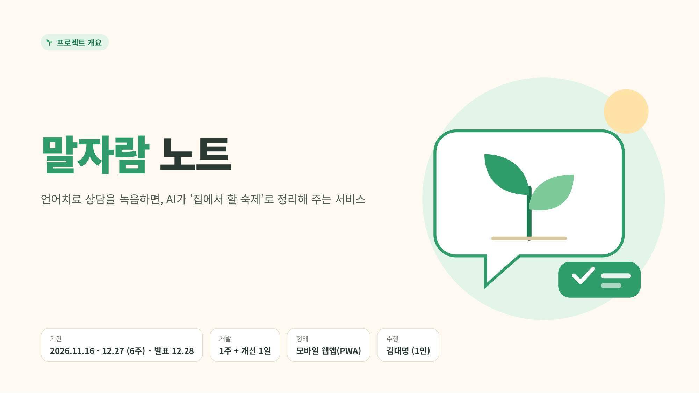
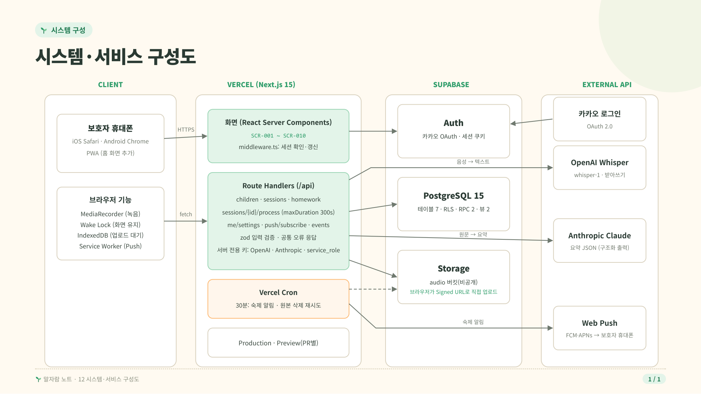

# 🌱 말자람 노트

> 언어치료 상담을 녹음하면, AI가 '집에서 할 숙제'로 정리해 주는 모바일 웹앱(PWA)



| 기간 | 개발 | 형태 | 수행 |
|---|---|---|---|
| 2026.11.16 – 12.27 (6주) · 발표 12.28 | MVP 7일(11/30–12/06) + 개선 1일(12/15) | 모바일 웹앱(PWA) | 김대명 (1인: 기획 · 설계 · 개발 · 검증 · 발표) |

## 왜 만들었나

아이 언어치료 · 감각통합치료는 비용이 크고 회기가 적어서 오래 다녀야 합니다. 치료가 끝난 뒤 5~10분 상담에서 듣는 "집에서 이렇게 해 주세요"를 놓치지 않고 실천하게 도와, 치료 기간과 보호자의 경제적 부담을 줄이고 아이 발달을 더 활발하게 하는 것을 목표로 했습니다.

## 주요 기능

1. **녹음만 하면 된다**: 녹음 동의 확인, 최대 15분, iOS용 mp4 대체, 화면 꺼짐 방지(Wake Lock), 업로드 실패 시 IndexedDB에 보관 후 재시도
2. **AI가 4칸으로 정리**: 받아쓰기(Whisper) → 요약(Claude)으로 오늘 한 활동 / 아이 반응 / 집에서 할 숙제 / 다음 목표. 구조화 출력 + zod 검증, 진단 · 조언 문구 금지, 원본 음성 자동 삭제
3. **숙제를 실천하게**: 숙제 체크리스트와 주간 진행률, 회기 타임라인, 매일 정한 시각에 Web Push 알림

## 구성



| 구분 | 기술 |
|---|---|
| 화면 · API | Next.js 15 (App Router, Route Handler 18개), TypeScript |
| 인증 · DB · 파일 | Supabase (카카오 로그인, Postgres 테이블 7개 + RLS, Storage) |
| AI | OpenAI Whisper (받아쓰기, 치료 용어 사전 48개), Anthropic Claude (요약) |
| 알림 · 배포 | Web Push, Vercel Cron(30분), Vercel |
| 테스트 | Vitest 자동 테스트 30개 (외부 서비스는 모의 객체) |

## 폴더

| 경로 | 내용 |
|---|---|
| [`maljaram-note/`](maljaram-note/) | 앱 · 서버 코드. 실행 방법은 [maljaram-note/README.md](maljaram-note/README.md) |
| [`산출물/`](산출물/) | 기획 · 설계 · 검증 산출물 28종과 발표자료. 목록은 [산출물/README.md](산출물/README.md) |
| [`_이전_초안/`](_이전_초안/) | 산출물을 정리하기 전의 초기 문서 |

주요 산출물: [요구사항 명세서](산출물/08_요구사항_명세서.xlsx) · [API 명세서](산출물/15_API_명세서.xlsx) · [ERD](<산출물/14_DB_설계(ERD).pdf>) · [테스트 · 검증 결과](산출물/19_테스트·검증_결과.xlsx) · [이슈관리대장](산출물/31_이슈관리대장.xlsx) · [발표자료](<산출물/말자람 노트_발표자료.pdf>)

## 실행

```bash
cd maljaram-note
npm install
npm test           # 단위 테스트 (외부 서비스 없이 실행)
npm run dev        # http://localhost:3000 (Supabase · API 키 필요)
```

환경 변수와 Supabase · 카카오 설정은 [maljaram-note/README.md](maljaram-note/README.md)를 참고하세요.

> ※ 산출물의 인터뷰 · 사용자 테스트 · AI 평가 수치는 계획 단계에서 작성한 예시값입니다.
