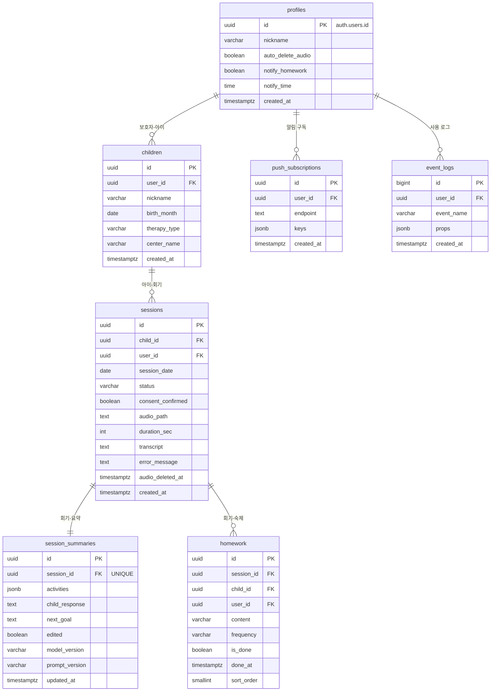

# 말자람 노트 ERD

- DBMS: PostgreSQL 15 (Supabase)
- 모든 테이블에 RLS 적용: `user_id = auth.uid()` 또는 소유 관계를 따라 검사
- 상세 컬럼 정의는 `테이블정의서_말자람노트.docx` 참고

## 설계 메모
- `sessions.user_id`, `homework.user_id`는 정규화 관점에서는 중복이지만, RLS 정책을 조인 없이 `user_id = auth.uid()`로 단순화하려고 의도적으로 두었습니다.
- `session_summaries.prompt_version`으로 5주차 프롬프트 개선 전후의 요약 수정 비율을 비교합니다.
- 회기 삭제 시 `session_summaries`, `homework`는 `ON DELETE CASCADE`, 음성 파일은 API에서 Storage를 먼저 삭제합니다.
